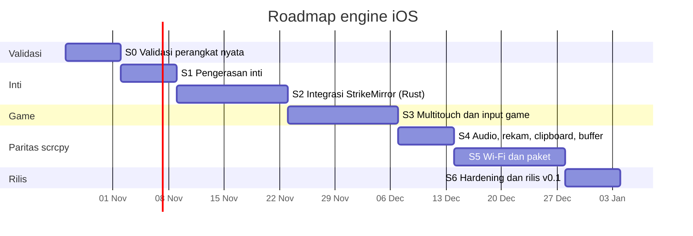

# Rencana sprint

Format: sprint 1 minggu, satu orang (pemilik) + Claude. Setiap sprint: perencanaan (pilih item), catatan harian singkat di issue, review (demo di perangkat), retro (3 baris di `docs/RETRO.md`). Batas pekerjaan berjalan: maksimal 2 item sekaligus. Tanggal adalah estimasi mulai Senin 2026-10-26.

## Definisi selesai (berlaku untuk semua item)
1. Tes otomatis ditulis dulu dan terbukti gagal sebelum kode (TDD), lalu hijau.
2. Seluruh suite hijau di CI (Ubuntu dan Windows) dan lint bersih.
3. Perilaku yang menyentuh iPhone dicatat hasil uji nyatanya di `docs/DEVICE-MATRIX.md`; item yang belum diuji di perangkat berstatus "belum terverifikasi", bukan "selesai".
4. Dokumen terkait (`PROTOCOL.md`, README) diperbarui.

## S0: Validasi perangkat nyata (gerbang untuk semua sprint lain)
- Jalankan `tools/smoke_test.py` dan `player.py` di tiap iPhone yang tersedia; isi `DEVICE-MATRIX.md` (model, iOS, hasil, fps, waktu frame pertama).
- Ukur: fps terdekode, latensi tap-ke-layar (rekam layar PC + HP), perilaku layar terkunci, tap pertama hilang atau tidak.
- Jalankan `bridge/multitouch_probe.py`.
- **Keluar jika:** minimal 1 perangkat tercatat; versi iOS minimum ditetapkan; keputusan multitouch (lanjut / fallback / tolak) tertulis.
- Risiko: tidak ada iPhone iOS 27 untuk menguji klaim #4.

## S1: Pengerasan inti
- Perbaiki temuan S0; siklus hidup bridge (matikan proses yatim, port bentrok); cabut-colok otomatis tersambung lagi; log berputar.
- Pemetaan koordinat saat layar diputar; scroll mouse menjadi swipe; F11 fullscreen; tombol MOD ala scrcpy.
- **Status kode (belum terverifikasi di iPhone):** lifecycle bridge, supervisor respawn, log berputar, MOD/F11, scroll, kompensasi crop "layar menyusut" selesai dan teruji otomatis. Sisa: temuan S0 dan uji keluar (30 menit, 3x cabut-colok).
- **Keluar jika:** 30 menit tanpa intervensi, 3 kali cabut-colok pulih sendiri.

## S2: Integrasi StrikeMirror (Rust)
- Perluas `video_pipeline.rs` ke HEVC (DXVA H.265); abstraksi "device backend" (Android scrcpy / iOS bridge).
- Backend iOS di Rust: parser bingkai, klien HTTP, peluncur bridge, wizard status; tes kontrak memakai server tiruan yang sama.
- **Keluar jika:** layar iPhone tampil di StrikeMirror dengan tap satu jari berfungsi; tes kontrak Rust hijau.

## S3: Multitouch dan input game
- Sesuai keputusan S0: implementasi dua kontak, atau jalur fallback, atau satu jari terdokumentasi.
- Hubungkan aim/D-pad/tombol StrikeMirror ke input iOS; atur `injection_rate_hz`; ukur latensi.
- **Keluar jika:** satu game nyata dimainkan 10 menit dengan joystick + tombol bersamaan (atau keputusan "tidak mungkin" dengan bukti).

## S4: Paritas scrcpy A
- Audio diputar di PC; rekam `--record` (remux HEVC ke mp4 tanpa re-encode); clipboard otomatis dua arah; `--video-buffer`; screenshot; opsi CLI.
- **Keluar jika:** rekam 5 menit menghasilkan mp4 yang bisa diputar; audio tidak drift lebih dari 200 ms.
- Status 2026-10-21 (teruji otomatis, **belum di iPhone**): `AudioSession` (sounddevice/PortAudio), `--no-audio`, `--audio-buffer`, `ClipboardSync` dua arah + `--no-clipboard-autosync`, `--record`, `-f/--fullscreen`, `--window-title`. Belum: `--video-buffer`, sinkron clipboard gambar, ukuran drift audio.

## S5: Wi-Fi dan paket
- Wi-Fi lewat RemotePairing (rujukan: Pane); bridge menjadi `.exe` (PyInstaller); wizard pertama kali; pin versi pymobiledevice3 + canary.
- Tambah `release.yml` (build di tag) **dan ujilah** di runner Windows.
- **Keluar jika:** instalasi bersih di PC lain berjalan sampai layar tampil.

## S6: Hardening dan rilis v0.1
- Soak 2 jam; periksa kebocoran memori/handle; dokumentasi pengguna; tinjauan hukum batas GPL; tag v0.1.
- **Keluar jika:** soak lulus, semua dokumen mutakhir, rilis dibuat.

## Metrik yang dilacak
fps terdekode, waktu ke frame pertama, jumlah dekode-error per jam, jumlah restart sesi per jam, cakupan tes, jumlah perangkat/iOS di matriks.
