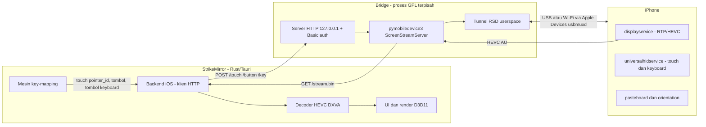
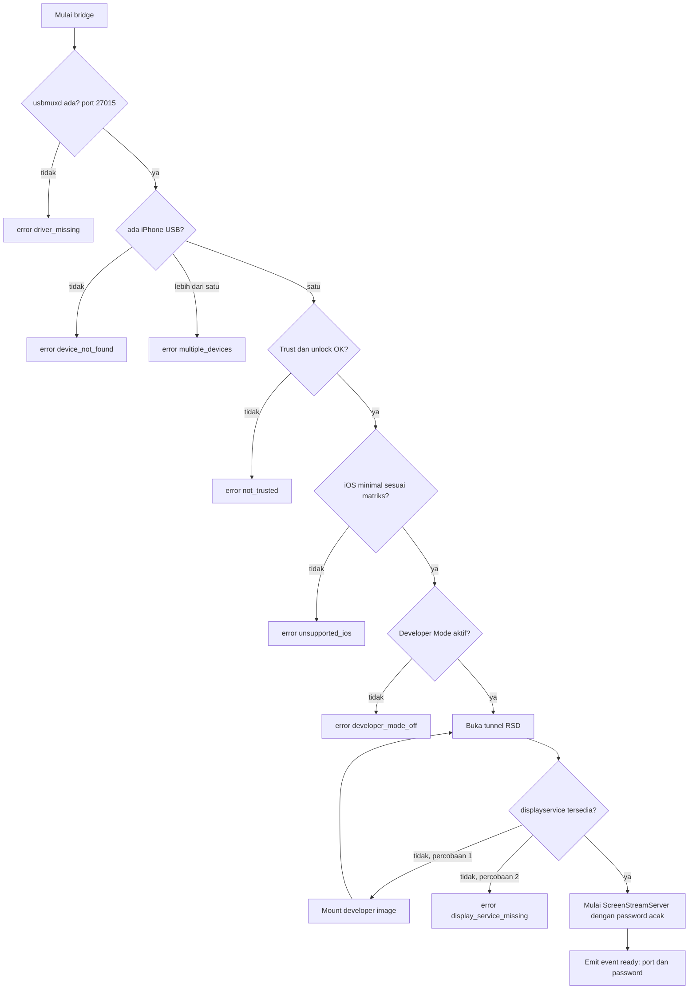
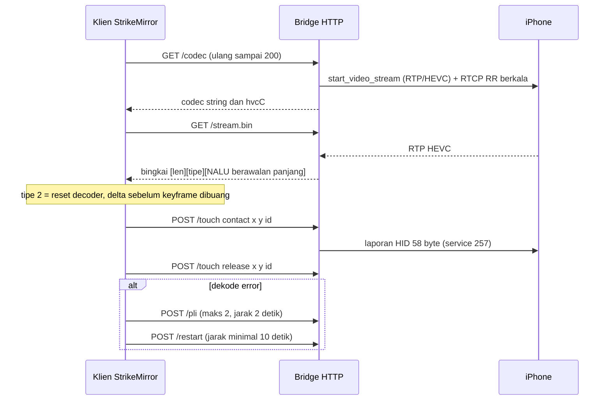
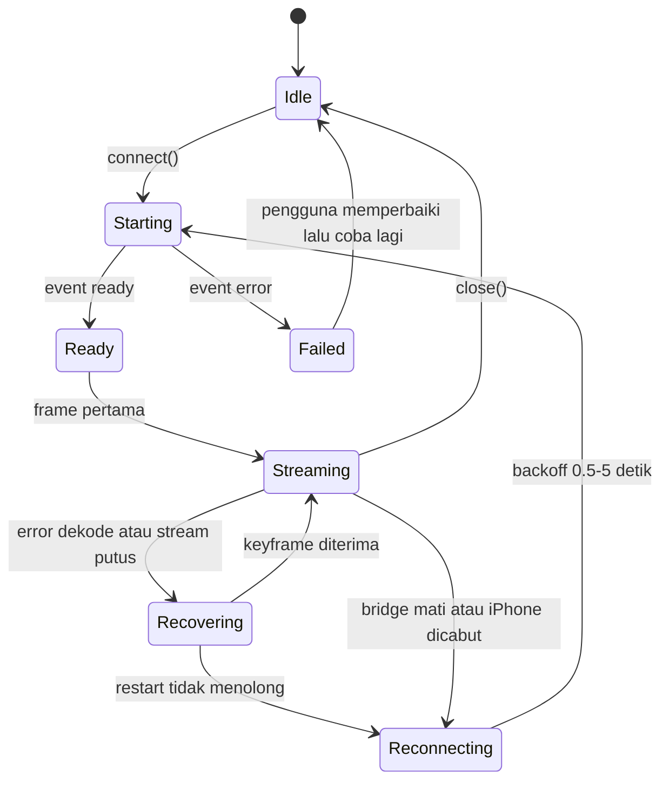
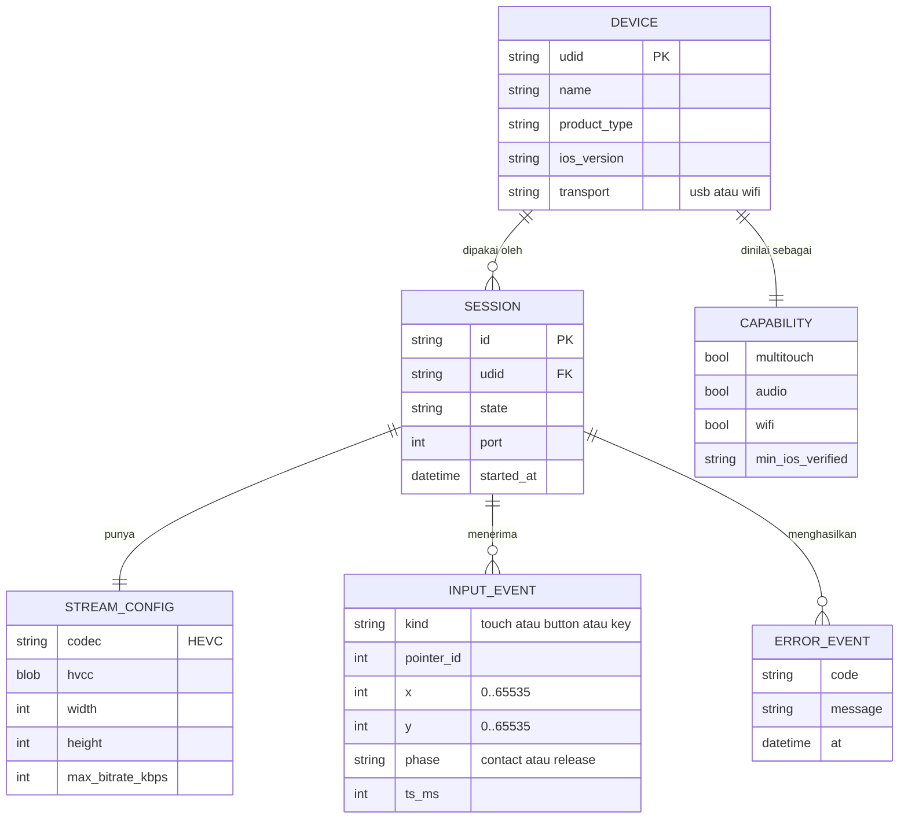

# Engine iOS untuk StrikeMirror: desain

Status: **draf menunggu review pemilik**. Sumber dan tingkat keyakinan: [`../../RESEARCH.md`](../../RESEARCH.md).

## 1. Tujuan dan kriteria sukses

Engine yang membuat iPhone terasa seperti perangkat Android di StrikeMirror/scrcpy: colok USB, layar muncul, kontrol dari PC, cukup rendah latensi untuk game. Prioritas pertama (dijawab pemilik): **game + key mapping**.

Kriteria sukses (harus terukur di perangkat nyata):
1. Dari colok sampai frame pertama: **< 10 detik** setelah setup satu kali.
2. Frame ke layar: target **>= 55 fps** terdekode, tanpa antrean yang menumpuk.
3. Tap sampai terlihat di layar: dicatat (target ditentukan di Sprint 0 setelah ada angka dasar).
4. Pulih otomatis dari dekode rusak dan cabut-colok tanpa restart aplikasi.
5. Multitouch **atau** keputusan tertulis bahwa multitouch tidak mungkin dengan bukti probe.

## 2. Pemahaman (yang dikatakan vs asumsi)

Dikatakan pemilik: StrikeMirror miliknya sendiri (Rust/Tauri di repo, Windows), memakai scrcpy-server, punya mesin key mapping; fokus game; ingin hasil "mirip scrcpy 5.x"; repo engine terpisah bernama `ScrpcyiOS`.
Asumsi saya (perlu dikonfirmasi): iPhone target minimal iOS 17.4; PC Windows 10/11 x64; satu iPhone per sesi; tidak ada jailbreak.

## 3. Keputusan

| ID | Keputusan | Alasan (lihat RESEARCH) | Alternatif yang ditolak |
|----|-----------|-------------------------|-------------------------|
| D1 | **Sidecar bridge** (proses terpisah, HTTP lokal) membungkus pymobiledevice3 | #1, #7, #8: tidak ada library Rust yang punya displayservice/HID; menulis ulang besar | Backend Rust native (ditunda, Sprint 7+), WDA (latensi tinggi, perlu app di HP) |
| D2 | Batas lisensi = **batas proses**; klien tidak pernah `import pymobiledevice3` | #6, #12 | Menggabungkan kode ke StrikeMirror (memaksa GPL) |
| D3 | Pemulihan video = **PLI terbatas lalu restart sesi**, bukan PLI terus-menerus | #3 | PLI tiap error (bisa merusak encoder) |
| D4 | Kontrak touch memakai **`pointer_id`** sejak v1; satu jari sampai probe membuktikan lebih | #1, #2 | Menunggu multitouch dulu baru merancang API |
| D5 | Matriks iOS ditentukan **dengan tes perangkat** di Sprint 0, bukan dari klaim README | #4 | Percaya "17.4+" atau "27+" begitu saja |
| D6 | Decoder StrikeMirror diperluas ke **HEVC** (iPhone tidak menawarkan H.264 di jalur ini) | kode StrikeMirror `video_pipeline.rs` hanya menerima H.264 | Transcode di bridge (menambah latensi dan CPU) |
| D7 | Mode Gamepad BLE **bukan** jalur utama | #11 | Menjadikannya rencana A |

## 4. Arsitektur

Batas penting: antara `BE` dan `API` hanya HTTP + JSON + aliran biner berbingkai. Tidak ada memori bersama.

## 5. Alur startup

## 6. Urutan video dan input

## 7. State machine sesi (klien)

## 8. Model data (ERD logis)

Engine hampir seluruhnya dalam memori. Yang disimpan ke disk hanya record pairing dan cache developer image (dikelola pymobiledevice3/OS). ERD ini mendokumentasikan entitas yang dipertukarkan lewat kontrak.

## 9. Taksonomi error

`driver_missing`, `device_not_found`, `multiple_devices`, `not_trusted`, `unsupported_ios`, `developer_mode_off`, `display_service_missing`, `stream_not_ready`, `stream_http`, `bad_frame`, `bridge_exited`, `timeout`, `unknown`. Setiap kode punya pesan Indonesia yang memberi tahu pengguna langkah berikutnya (`bridge/ios_bridge.py: MESSAGES`).

## 10. Risiko dan pertanyaan terbuka

| Risiko | Kemungkinan | Dampak | Mitigasi |
|--------|-------------|--------|----------|
| Versi iOS minimum ternyata 27 | sedang | tinggi (pasar sempit) | Sprint 0 matriks nyata; jalur QuickTime USB (iPhoneMirror) hanya dievaluasi bila perlu |
| Multitouch tidak bisa lewat HID | sedang | tinggi untuk game | Probe; fallback WDA (latensi) atau keputusan "satu jari saja" didokumentasikan |
| Apple mengubah protokol di rilis iOS berikutnya | tinggi | sedang | Tes kontrak API pymobiledevice3 + job canary mingguan + versi dikunci |
| PLI diabaikan, gambar rusak lama | sedang | sedang | `RecoveryPolicy` + restart sesi |
| GPL: batas proses diperdebatkan | rendah-sedang | tinggi | Tinjauan hukum sebelum rilis komersial; kontrak HTTP sempit |
| Encoder dibatasi ~6 Mbps, kualitas turun saat gerak | sedang | sedang | Uji; `--max-bitrate`, `motion_idr` dikonfigurasi |
| Kunci layar menghentikan stream | tidak diketahui | sedang | Uji di Sprint 0 |

## 11. Strategi tes

Piramida: **unit** (framing, kebijakan pemulihan, builder laporan HID, pemetaan tombol) -> **konformansi dengan bridge tiruan** (server HTTP yang meniru protokol, video HEVC asli dihasilkan saat tes) -> **kontrak API pymobiledevice3** (deteksi drift) -> **hardware-in-the-loop** (`tools/smoke_test.py` di runner terdaftar yang dicolok iPhone). Bridge tiruan sama dipakai backend Rust nanti untuk tes kontrak.

## 12. Di luar cakupan

Mirror kamera, display virtual, drag-drop file/APK, mode OTG, pilihan codec/FPS, jailbreak, mirror iPad khusus, AirPlay.
